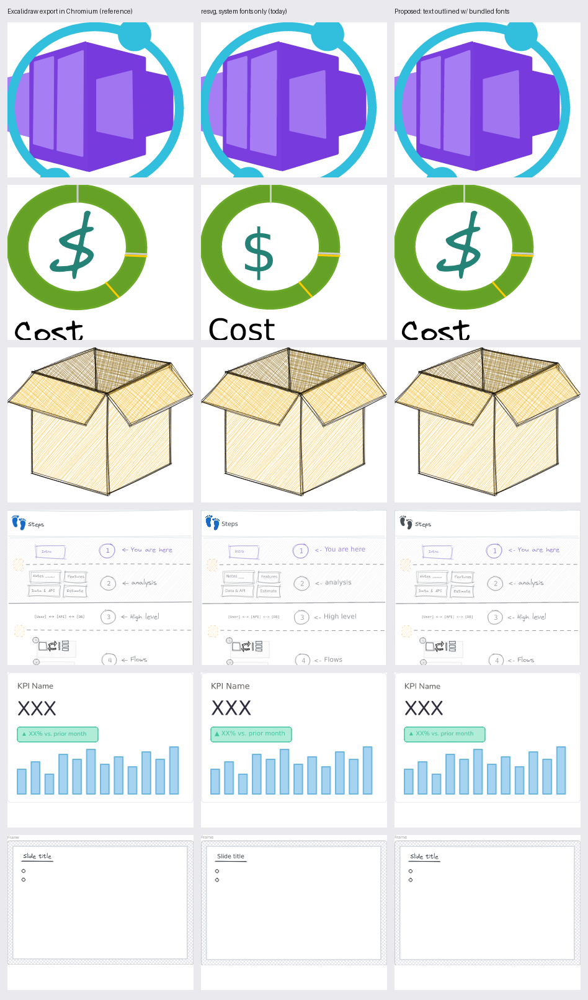

# Excalidraw library support: feasibility

> **Decision (2026-10-23):** support Excalidraw through the standalone converter
> `tools/excalidraw-to-svg` (`just excalidraw`), not inside the app. See §8. §§4–6 describe the
> in-app design that was *not* chosen; keep them for reference if in-app support is revisited.

**Verdict: feasible, with one architectural inversion.** Iconarium can browse `.excalidrawlib` items and copy them as SVG
with near-Excalidraw fidelity. The catch is that conversion runs in JavaScript (Excalidraw's own exporter). It has to
execute in a WebView, then hand the SVG back to the Rust pipeline. Everything downstream (index, search, thumbnails,
viewer, region crop, clipboard, drag) can stay unchanged if converted items are materialized as cached `.svg` files.

Evidence comes from a spike against the public catalog (`excalidraw/excalidraw-libraries`, 232 libraries, 4,187
items), using `@excalidraw/utils@0.1.7` in headless Chromium plus resvg/usvg 0.48 (the same version Iconarium links).

---

## 1. Format

`.excalidrawlib` is a JSON document. There are two on-disk versions, and both occur in the catalog.

| | v1 (70 of 232 files) | v2 (162 of 232 files) |
|---|---|---|
| Shape | `{type:"excalidrawlib", version:1, source, library: Element[][]}` | `{type:"excalidrawlib", version:2, source, libraryItems:[{id, status, created, name?, elements: Element[]}]}` |
| Item identity | Array index only | `id` (stable), optional `name` |
| Item names | None | 75% named (1,044 of 4,187 items unnamed overall) |
| Binary files | `files` map possible (image elements) | Same. **0 libraries in the catalog use it** |

A library item is a list of Excalidraw elements. It's a scene description, not vector art:

| Property | Catalog distribution | Rendering implication |
|---|---|---|
| Element types | line 23.6k · rectangle 11.8k · ellipse 8.2k · text 7.3k · freedraw 2.7k · arrow 1.0k · diamond 366 · legacy `draw` 115 · frame 14 | Every type renders through Excalidraw's own shape code |
| `roughness` | 0 (architect) 40% · 1 (artist) 52% · 2 (cartoonist) 9% | **Hand-drawn strokes come from rough.js at export time.** Output is seeded by element `seed`, and I confirmed it is deterministic across runs and reloads |
| `fillStyle` | solid 74% · hachure 20% · cross-hatch 7% | Hachure fills expand into many paths |
| Text `fontFamily` | 1 Virgil 5,037 · 5 Excalifont 779 · 3 Cascadia 641 · 2 Helvetica 465 · 6 Nunito 349 · 8 Comic Shanns 39 · 7 Lilita One 5 | Six custom web fonts plus Helvetica, so **fonts are the main fidelity problem** |
| Bound text (`containerId`) / frames | 658 / 14 frame elements | Handled by the exporter |
| Size | elements per item: p50 7, p90 26, p99 125, max 542. Items per file: median 9, max 249 (AWS). File size median 121 KB, max 4.9 MB | Fine |

## 2. Conversion options

| Option | How | Fidelity | Cost and risk | Verdict |
|---|---|---|---|---|
| **A. Excalidraw exporter in a WebView** | `exportScene({type:"svg"})` from `@excalidraw/utils` in a hidden Tauri window. SVG text returned over IPC | Exact (it *is* Excalidraw) | JS dependency, about 20 MB bundle (see §5), API churn | **Recommended** |
| B. Embedded JS engine in Rust | rquickjs + linkedom (`exportScene` accepts `environment.document`) | Exact, in theory | No V8 JIT: rough.js and a 20 MB bundle parse slowly. No FontFace API. Unproven | Fallback only if headless conversion inside `svg-core` becomes a hard requirement |
| C. Native Rust port | rough.js port (`roughr`), perfect-freehand port, re-implemented arrowheads, roundness, text layout, frames, legacy migrations | Drifts. Seeds must reproduce rough.js's RNG exactly | Large, plus a permanent maintenance treadmill tracking Excalidraw | Not recommended |

## 3. Spike results (option A)

| Measurement | Result |
|---|---|
| Items converted | **4,187 of 4,187, 0 errors, 0 empty outputs** (including the 34 items using the legacy `draw` type, and both v1 and v2 files) |
| Time per item (Chromium, one thread) | p50 18 ms · p90 42 ms · p99 100 ms · max 414 ms. 79 s cumulative for the whole catalog |
| With `skipInliningFonts: true` | 4–16 ms on items where font inlining cost 40–370 ms |
| Exported SVG size | p50 9 KB · p90 41 KB · p99 168 KB · max 1.8 MB |
| Determinism | Byte-identical across runs and page reloads, so it can be cached by content hash |
| resvg geometry vs Chromium | Visually identical for rough strokes, hachure and cross-hatch, freedraw, dashes, arrows, frames |
| resvg text, as shipped | **Excalidraw fonts are ignored.** resvg skips `@font-face` (`simplecss: The @font-face rule is not supported`) and falls back to sans-serif (Arial on Windows) |
| resvg text with bundled fonts | Matches, once the fonts are loaded into fontdb and Nunito's family name is aliased (the shipped TTF is named "Nunito ExtraLight Medium") |
| usvg text-to-path with bundled fonts | 2,446 of 2,446 text items outlined, 0 failures, no `<text>` left. Size ratio vs Excalidraw's subset-font SVG: p50 2.2×, p90 4.8×, max 60× (an 8,000-character handwriting canvas becomes 1.5 MB). Max output 4.1 MB, inside the 25 MB / 100k-node limits |
| Font subsets for Rust (Latin, Greek, Cyrillic, symbols) | 7 fonts, 1.07 MB total, **0.31 MB compressed** |



*Left: Excalidraw export rendered in Chromium. Middle: Iconarium's renderer today (fonts fall back). Right: the proposed pipeline (text outlined with bundled fonts).*

## 4. Recommended architecture

```text
scanner ── *.svg ───────────────────────────────────────────────▶ existing pipeline
        └─ *.excalidrawlib ─▶ expand job (Rust, serde_json)
                               parse v1/v2 → N child assets
                               relative_path = "net/aws.excalidrawlib#<id|index>"
                               name = item.name ?? "<library> #N"
                               fingerprint = blake3(container fp, item key, item JSON)
                                   │  batch (visible items first)
                                   ▼
                     hidden "excalidraw-converter" WebView (Vite 2nd entry, lazy bundle)
                     exportScene({type:"svg", config:{skipInliningFonts:true,
                                  canvasBackgroundColor:false, padding:…}})
                                   │  invoke("excalidraw_converted", {key, svg})
                                   ▼
                     Rust: usvg parse with shared fontdb (+ bundled Excalidraw fonts)
                           → write text-outlined SVG, inject <title>name</title>
                             <desc>library · item text</desc>
                           → cache/excalidraw/<libhash>/<NNN-name>.svg
                                   │
                                   ▼
          existing pipeline, unchanged: analyze → thumbnail → viewer → crop → copy/drag
          (AppCore::absolute_path() maps virtual assets to their cache file)
```

Key decisions:

| Decision | Choice | Why |
|---|---|---|
| Unit of conversion | One library file per batch, child items stream back | Parse once. At about 18 ms per item, even AWS (249 items) is about 5 s cold, then cached |
| Where conversion runs | A dedicated hidden window, not the main UI | Keeps the gallery's main thread free, and lets its capability allow exactly one command |
| Canonical bytes | **Text-outlined SVG** | One file that renders correctly in resvg, `` in the viewer, Office, Inkscape and Figma with no font dependency. resvg, the WebView and Office all ignore embedded `@font-face` in some way |
| Search | `<title>`/`<desc>` injected from item name, library name and text elements | The existing `text_extract` indexes them, so no search changes are needed. Outlined SVGs have no `<text>` left to index |
| Fonts | Bundle subset TTFs as resources, load into `shared_fontdb()`, alias `Nunito`, optionally map `Helvetica` → Liberation Sans | 0.31 MB compressed. All OFL-1.1, so add them to third-party notices |
| CSP | **No change needed** with `skipInliningFonts` | Excalidraw's glyph subsetter needs `'unsafe-eval'`, and under the current CSP silently falls back to embedding whole fonts (3–5× larger). Avoiding font inlining avoids the problem entirely |
| Library file in the gallery | Show the `.excalidrawlib` as a virtual folder (`rel_dir` = `…/aws.excalidrawlib`) | Fits the existing folder and path model, and makes `aws.excalidrawlib/*` glob searches work |

## 5. Limitations

| # | Limitation | Severity | Mitigation |
|---|---|---|---|
| 1 | Conversion needs a JS runtime, so `svg-core` stays headless but can't convert. Rust tests need checked-in golden SVGs | Medium | `tools/excalidraw-goldens.mjs` (Playwright and the same bundle) regenerates fixtures. E2E covers the live path |
| 2 | **Copied SVG text is outlined**: not editable or selectable in the target app. Files are larger (2.2× median, up to about 60× for text-heavy items) | Medium | Secondary "Copy SVG (live text)" re-exports with embedded fonts on demand. Good in browsers, Inkscape and Excalidraw; Office will substitute fonts |
| 3 | `@excalidraw/utils` API churn: `exportToSvg` (0.1.5, Sep 10) became `exportScene` (0.1.6/0.1.7, Oct 19–20). 0.1.7 is 3 days old | Medium | Pin exactly, wrap behind a 20-line adapter, guard with golden tests. Upgrade deliberately |
| 4 | Bundle weight: about 19.8 MB JS (about 14 MB compressed). It's mostly inlined woff2 chunks (CJK Xiaolai) that `skipInliningFonts` never uses | Medium | Lazy-load only in the converter window. Try stubbing the font modules at build time (pass `environment.loadFonts: async () => {}`) and verify output is unchanged. That could cut it to a few MB. Not yet tested |
| 5 | CJK text: bundled subsets are Latin, Greek and Cyrillic, so CJK falls back to Windows system fonts, not Excalidraw's Xiaolai | Low | Accept, or bundle Xiaolai (large) behind a setting |
| 6 | Shaping differences: Excalidraw handwriting fonts render `<-` as an arrow ligature in Chromium, but resvg/rustybuzz leaves `<-`. Emoji fall back to a monochrome outline | Low | Cosmetic. Check emoji with Segoe UI Emoji on Windows |
| 7 | Image elements (`files` map, data URLs) are untested: 0 samples in the catalog | Low | Exporter supports them. They become `<image>` data URIs under the existing embedded-raster limits. Add a fixture |
| 8 | Identity for v1 items is index-based. Reordering items in a library file changes keys, so those items get re-converted and lose thumbnail cache | Low | Content-hash fingerprints make re-conversion cheap. v2 items use `id` |
| 9 | Exports are light theme only by default | Low | `theme: "dark"` is a one-line option if wanted |
| 10 | Frames export with an outline and a "Frame" label | Low | `frames: {name:false, outline:false}` if those look like noise |
| 11 | Office paste fidelity is unverified on real Windows Office | Validate | Add rows to `windows-validation.md`: paste outlined SVG and its PNG fallback into Word and PowerPoint |

## 6. Change list

| Area | Files | Size |
|---|---|---|
| Discovery and watch: accept `.excalidrawlib` | `library/scanner.rs` (`is_svg_name` → `is_supported_name`), `app/watch.rs` | S |
| Library parsing: v1/v2, item keys, names, text, fingerprints | new `crates/svg-core/src/excalidraw.rs` + tests | M |
| Schema v2: container/child link (`parent_id`, `item_key`), cascade on container delete | `index/migrations.rs`, `index/database.rs` | S–M |
| Expand and reconcile jobs, cache dir, `absolute_path` for virtual assets, "Reveal" opens the container | `app/library.rs`, `app/mod.rs`, `app/paths.rs` | M |
| Converter window: hidden WebView, Vite multi-page entry, one capability-scoped command, queue with batching, timeouts and generation checks | `src-tauri` (window + command), `capabilities/`, `vite.config.ts`, new `src/excalidraw-worker/` | M–L |
| Outline and annotate: usvg parse → `to_string`, `<title>/<desc>` injection | `svg/` (new `outline.rs`) | S |
| Fonts: subset at build time, ship as resources, load into fontdb, aliases | `tools/subset-fonts.*`, `svg/renderer.rs`, `tauri.conf.json` resources | S |
| UI: library-file badge or folder, item names, optional "Copy SVG (live text)" | `AssetCard.tsx`, `AssetContextMenu.tsx`, `api/types.ts`, mock backend | S–M |
| Tests: golden SVGs, parser unit tests, E2E | `tests/`, `scripts/e2e/` | M |

Optional extras:
- **Copy as Excalidraw.** Put `{"type":"excalidraw/clipboard","elements":[…],"files":{}}` on the clipboard as text so items paste into excalidraw.com as editable shapes. Not tested.
- **`.excalidraw` scene files.** Treat each as a one-item library.

## 7. Open questions

1. Copy default for Excalidraw items: outlined text (portable, recommended) or live text with embedded fonts?
2. Gallery presentation: should a library file show as a virtual folder (recommended) or as one card that opens a sub-gallery?
3. Is about 14 MB of installer growth acceptable if the font-stub trim (limitation 4) doesn't work?

## 8. Chosen approach: standalone converter (implemented)

`tools/excalidraw-to-svg` converts libraries into folders of plain SVG files, which Iconarium
then browses like any other library. Nothing in the app changes. Usage and options are in
`tools/excalidraw-to-svg/README.md`.

| Aspect | In-app design (§4) | Standalone converter |
|---|---|---|
| App changes | Schema v2, hidden converter WebView, expand/convert jobs, fonts in fontdb | None |
| Installer size | About +14 MB | Unchanged |
| Where Excalidraw's exporter runs | WebView2 | Plain Node: `exportScene` gets a linkedom DOM through its `environment` option (0.1.7+) |
| Text | Outlined in Rust with usvg | Outlined with resvg-js (same engine) by default; `--text live` keeps text and embeds font subsets |
| Fonts | Bundled subsets loaded into fontdb | The TTFs inside `@excalidraw/utils`, loaded in place: none copied or modified. System fonts load only for characters those fonts lack |
| Search | `<title>/<desc>` injected | Same: item name, library, `--meta` summary and keywords, visible text |
| Staying current | Watcher | Re-run. Unchanged libraries are skipped via a manifest; renamed or removed items and deleted libraries are cleaned up |

Results:

| Run | Items | Errors | Time | Notes |
|---|---|---|---|---|
| Public catalog, 232 libraries | 4,187 | 0 | 45 s cold, 0.7 s re-run | All parse and render with resvg 0.48; max 1,786 nodes, 4 MB; no `<text>` left |
| Eric's mirror, 116 libraries (`--meta tools/vision.json`) | 1,556 | 0 | 48 s (I/O on a shared folder) | All 51 image-based brand logos preserved; every item gets a descriptive name |

Measured along the way:
- Font cost per SVG is 4–34 ms with warm caches (the earlier "586 ms" was a cold read).
- System-font scanning costs 50–200 ms, hence loading it only when needed.
- Live mode needs two shims (`FontFace`, and CommonJS `__dirname`/`require` for the HarfBuzz subsetter). With them, output matches the Chromium export within a few hundred bytes.

Still to do:
- Run `just excalidraw` on Windows.
- `just bench datasets/excalidraw`.
- Paste outlined SVGs into Office (`windows-validation.md`).

